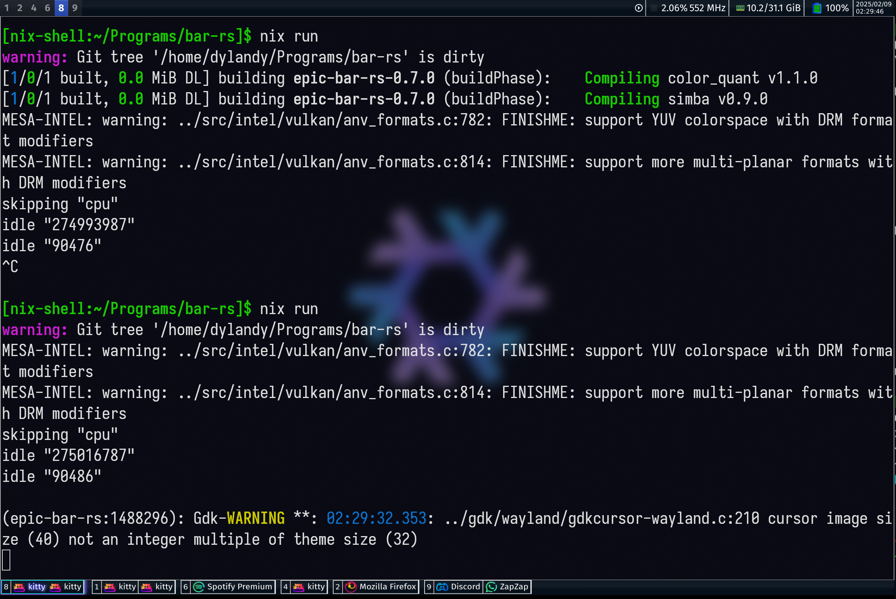

[](https://deps.rs/repo/github/DMGDy/epic-bar-rs)

# epic bar

:warning: **This is in development**: Currently the status bar I use every day



The screenshot is from an earlier version. The bar now uses the Autumn Light
theme by default; the original Windows-style theme is still included.

This started as a standalone reimplementation of a bar using
[Eww widgets](https://github.com/elkowar/eww) that I made
[here](https://github.com/DMGDy/eww-bar). It now has a top workspace/status bar
and a bottom task bar, using [GTK4](https://docs.gtk.org/gtk4/) and
[gtk4-layer-shell](https://github.com/wmww/gtk4-layer-shell).

This will only work on Hyprland as it communicates through Hyprland IPC sockets.
Workspace and window changes use one persistent connection shared by both bars;
system information is updated separately.

Application icons come from desktop entries and the current icon theme, with
bundled [Candy icons](https://github.com/EliverLara/candy-icons),
[Kora](https://github.com/bikass/kora), and a generic icon as fallbacks.
The Nix package also includes Papirus.

The bar's code is licensed under GPL-3. Bundled icons retain their upstream
licenses.

## What it shows

The top bar has:

* Workspaces 1-9, with an animated active-workspace indicator and click-to-switch.
* Playing or paused MPRIS media, with previous, play/pause, and next controls.
  Long track names scroll while the player is visible.
* Online physical network interfaces, with the IPv4 default-route interface
  first. Wi-Fi shows its SSID; clicking an interface opens addresses, gateways,
  and a Copy addresses button.
* CPU usage, RAM usage, and battery status when a battery is present. CPU and RAM
  open short history graphs; the more button reveals CPU frequency and memory
  capacity.
* A stacked date and clock. Clicking it opens a calendar.

The bottom bar shows open windows grouped by workspace, with application icons
and live window titles. Clicking a window focuses it, including across
workspaces. The groups and windows move into most-recently-used order rather
than being rebuilt every time focus changes. Long window titles scroll on hover;
the wheel or trackpad scrolls the task list when it does not fit.

Windows requesting attention highlight their task button and workspace in amber
until that window is focused or closed. This uses Hyprland's window-urgency
events, not desktop notifications: a Dunst notification alone does not
necessarily highlight anything. Attention missed while the bar is stopped or
disconnected cannot be recovered from the current JSON snapshots.

Animations and scrolling respect GTK's disabled-animation setting.

### Hover previews

Hovering a workspace or window opens a small image and details popup after a
short delay. Moving into the popup keeps it open.

Window previews use native toplevel capture, including windows on inactive
workspaces when Hyprland allows it. They refresh at most once per second while
hovered. Workspace previews are **last-seen images**, not live views of inactive
workspaces. Visible workspaces are sampled in the background, with a priority
capture after a visit and before opening a stale active-workspace preview.
Switching workspaces never waits for a screenshot.

Clicking a workspace preview switches there. Retry and scrollbar controls keep
their own behavior; window previews are hover-only.

Images stay in memory, with a shared limit of 32 images / 32 MiB of decoded
pixels, and are cleared when the session locks or the IPC connection fails.
Workspace captures pause while a preview is open to avoid capturing the popup
itself. Errors appear in the popup and stderr; use **Retry capture** after
addressing an error or a capture-permission prompt.

Previews need a recent Hyprland with stable window IDs, lock-state queries, and
foreign-toplevel image capture, plus `grim` 1.5 or newer and GNU `timeout`.
The Nix package supplies the capture tools. No capture permissions are changed
by the bar.

## Trying it out

If you are on NixOS or using Nix on your system and using Hyprland, you can try
it without cloning the repository if flakes are enabled:

```sh
nix run github:DMGDy/epic-bar-rs
```

If flakes are not enabled, clone the repo and then:

```sh
nix-build
./result/bin/epic-bar-rs
```

Stop an existing instance before launching another build of the bar.

### Modifying and Rebuilding

To make changes with flakes, enter the development environment:

```sh
nix develop
cargo run
```

Or without flakes:

```sh
nix-shell
cargo run
```

Both development shells also build the Nix package when entering. For a release
build or the normal tests:

```sh
cargo build --release --locked
cargo test --locked
```

To build the packaged version with flakes:

```sh
nix build
./result/bin/epic-bar-rs
```

Without Nix, you will need Rust 1.92 or newer, GTK 4.16 or newer,
gtk4-layer-shell 1.0 or newer, and their development dependencies. `iw` is used for Wi-Fi
SSIDs and `ip` for network details. Media controls use the session D-Bus directly;
they do not need `playerctl`.

## Themes

Themes are GTK CSS files loaded at startup for both bars. Editing a theme does
not require recompiling; restart the bar to apply it.

The default Autumn Light theme uses warm-white panels, cocoa text, peach
selections, red active indicators, and colored status icons. The top and bottom
bars target 48 px and 38 px respectively, with 16 px text.

The lookup order is:

1. `EPIC_BAR_THEME`, if set.
2. `$XDG_CONFIG_HOME/epic-bar-rs/theme.css`, or `~/.config/epic-bar-rs/theme.css`.
3. The installed `share/epic-bar-rs/themes/autumn-light.css`.
4. `theme.css` in the current directory, for development.

The repo's `theme.css` selects Autumn Light. To use the saved Windows-style theme
from the repo, change it to:

```css
@import url("themes/windows-11-light.css");
```

Or select a theme for one launch:

```sh
EPIC_BAR_THEME="$PWD/themes/windows-11-light.css" ./target/release/epic-bar-rs
```

Relative imports resolve against the CSS file's directory. An explicit missing
file, invalid CSS, or a missing import stops startup with an error instead of
silently selecting another theme.

## why?

Most of what I wanted the bar to show was already implemented through several
compiled tools for the Eww widgets, so naturally I wanted to implement it on its
own. These are the tools that generated the Eww code and system information:

* [workspaces](https://github.com/DMGDy/eww-workspaces)
* [statuses](https://github.com/DMGDy/statuses)
* [more statuses (in Rust)](https://github.com/DMGDy/statuses-rs)
* [Open windows in workspaces](https://github.com/DMGDy/eww-windows)

I previously relied on Rust crates for network and Wi-Fi information. The bar
now reads interface and route information from `/sys` and `/proc`, with bounded
`iw` and `ip` calls for the details. Direct Netlink interaction is still something
I would like to look at.

## TO-DO

* [X] Workspaces and open windows, with click-to-switch and application icons
* [X] Battery, CPU, RAM, date, and calendar
* [X] Active network interfaces and Wi-Fi SSIDs
* [X] Calendar, system-history, and network-detail popups
* [X] MPRIS controls and scrolling track/window titles
* [X] Window-attention highlighting
* [X] Window and last-seen workspace previews
* [X] Runtime CSS themes
* [ ] Wi-Fi signal strength
* [ ] PipeWire volume/mute controls
* [ ] Proper multi-monitor placement and output-hotplug handling
* [ ] Continue improving error handling

## Known Issues

* Only one pair of bars is created, rather than one per display.
* Turning a display off and on can require restarting the bar.
* Preview support depends on Hyprland's capture protocols and permissions.
  An inactive workspace without a cached image has no workspace preview yet.
* App-icon matching depends on desktop files and the icon theme; unmatched
  applications use the bundled or generic fallback.
